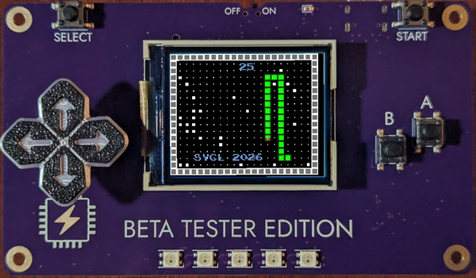
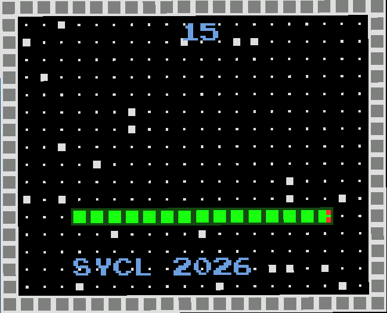
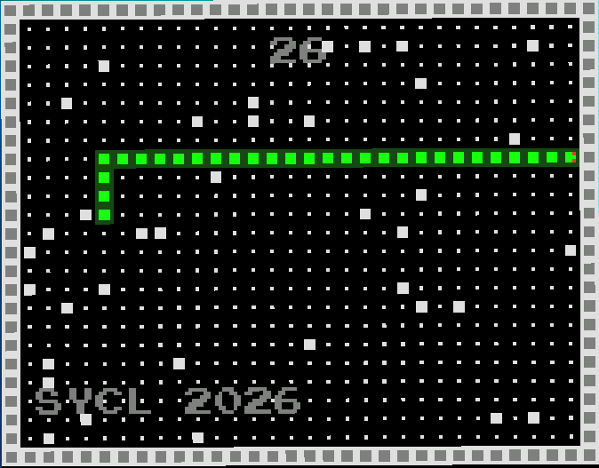

# 🐍 SYCL Snake

**Classic Snake, written in Zig, running on custom conference hardware.**

SYCL Snake is a game for the [Software You Can Love (SYCL) Vancouver 2026](https://github.com/ZigEmbeddedGroup/sycl-badge) conference badge. The badge is a handheld ARM board with a 160×128 color screen, a D-pad, five RGB LEDs, and a chiptune audio mixer. The game uses all of it: grid-based gameplay, a scrolling banner, LED light shows, and an original soundtrack built from scratch.


<p align="center"></p>

<p align="center">
  <br>
  <sub><i>SYCL Snake 2.0 running in the badge simulator</i></sub>
</p>

> **Where the code lives:** active development happens in my fork of the badge repo, under [`carts/sycl-snake`](https://github.com/CamoKnight117/sycl-badge/tree/main/carts/sycl-snake). This repo holds periodic snapshots of the source ([`src/main.zig`](src/main.zig)), plus my talk materials and conference notes.

## 🎤 Watch the talk

I presented SYCL Snake at the Utah Zig meetup, covering the design, the Zig code, and lessons from building for the badge.

<p align="center">
  <a href="https://www.youtube.com/watch?v=B6z4a6GZqvY&t=110s">
    
  </a><br>
  <sub><i><a href="https://www.youtube.com/watch?v=B6z4a6GZqvY&t=228s">SYCL Snake w/ Cam Knight</a> on YouTube</i></sub>
</p>

---

## Features

- **Snake on a 22×18 grid** with walls, growing length, and score tracking
- **Speed that ramps up** as the snake gets longer
- **Food that keeps spawning** over time, so the board fills up the longer you survive
- **Original chiptune audio:** a title jingle, a game-over theme, and pickup arpeggios with a special fanfare every 10 points
- **LED effects** on the badge's five NeoPixels: a chaser on the title screen and a red flicker on game over
- **Intro → game → game-over flow**, with your final board still visible behind the score

## How it works

A few design decisions I'm happy with:

**The board *is* the snake.** There's no array or queue of body segments. Each grid cell stores what's in it, and body cells store the direction they were travelling. To move, the game writes a new head ahead of the snake. Then it reads the direction stored at the tail, clears that cell, and steps the tail forward. Each move costs constant time and needs no extra memory, which matters on a microcontroller.

**A small audio sequencer.** The badge mixer plays single tones, so I built a lightweight sequencer on top of it. It queues up to 20 multi-note sequences, advances them frame by frame, and lets one-shot sound effects play alongside longer songs. The melodies are written in a hand-rolled note table (`c4`, `g4`, `e4b`, …) for easy composing.

**Debugging on hardware.** Zig's default panic handler hits a breakpoint, which silently hard-faults and resets the badge. I replaced it with one that sends the panic message over the USB console, then waits in a low-power loop so the message gets through before the badge halts. The game loop also emits trace breadcrumbs (`ss:tick`, `ss:draw-w`, …), so the last message in the console shows where a crash happened.

## From 1.0 to 2.0

<table>
  <tr>
    <td align="center" width="50%">
      <br>
      <b>Version 1.0</b><br>
      <sub>Large map, small squares, grey text</sub>
    </td>
    <td align="center" width="50%">
      <br>
      <b>Version 2.0</b><br>
      <sub>Tighter map, bigger squares, readable text</sub>
    </td>
  </tr>
</table>

**1.0** was the first playable build: the grid-stored snake, collisions, food, score, and a scrolling banner. Playtesting on the real badge led to **2.0**:

- **Readable text:** the grey score and banner blended into the board, so they're now light blue, with the final score in red.
- **See how you died:** your final board stays on screen behind "GAME OVER."
- **A tighter map:** the open area shrank from 690 cells to 320, so your own tail becomes the real threat.
- **Sized for the badge:** squares grew from 5 to 7 pixels, about 40% larger and easier to see on the small screen.
- **Bigger, cuter eyes:** they went from 1 pixel to 2×2 pixels, so you can see which way the snake is facing.

2.0 also added sound, random starting food, and input fixes so you can't reverse into yourself.

## Controls

| Input (Badge) | Input (Sim) | Action |
|---|---|---|
| D-pad | WASD | Steer the snake |
| START | ENTER | Start a game / return to title after game over |

## Build & run

You'll need **Zig 0.17.0**.

```bash
git clone https://github.com/CamoKnight117/sycl-badge.git
cd sycl-badge
zig build
```

Both versions build side by side: `sycl-snake` is 1.0 and `sycl-snake-v2` is 2.0.

- **Simulator:** run the `sycl-snake-v2` executable from `zig-out/sim/`.
- **On the badge:** plug it in over USB so it mounts as a drive, copy `zig-out/carts/sycl-snake-v2.uf2` onto it, and pick it from the badge menu.

## Also in this repo

- **[`PresentationForUtahZigOct8/`](PresentationForUtahZigOct8/)** has the slides from my talk on SYCL Snake at the Utah Zig meetup, October 8, 2026.
- **[`async-io-workshop/`](async-io-workshop/)** has my exercises and solutions from the SYCL 2026 workshop on Zig's async I/O: fibers, cancellation, groups, and select.

## Credits

Built on the [SYCL badge](https://github.com/ZigEmbeddedGroup/sycl-badge) cart API from the Zig Embedded Group. The color helpers are adapted from the badge's *space-shooter* cart, and the random-float helper from the *blobs* cart.

---

Made by **Cam Knight** · [GitHub](https://github.com/CamoKnight117) · [LinkedIn](https://www.linkedin.com/in/cameron-knight-607aa813b)
